# Ehlers cycle and filter operators: domain review pack (F3)

This pack is for the user's domain review of the Ehlers operators before 3.0.0.
For each operator it gives the published formula and its source, a link to our
code, the known-signal checks with plots, and the result. The automated checks
live in [`tests/test_ehlers_known_signals.py`](../../../tests/test_ehlers_known_signals.py)
(about 1 s). The first version of this pack (d7093ab) found four operators that
failed their checks and several doc errors. Task 33 fixed them by following
Ehlers' published routines as TA-Lib implements them (the user's rule: follow
the popular convention of the papers and other libraries; only where there is
none, choose for internal consistency). The sections below give each
operator's convention, its source, the values before and after the fix, and
the agreement with TA-Lib. No check is marked xfail any more.

The plots are regenerated by
[`ehlers/make_plots.py`](ehlers/make_plots.py), which imports the signals from the
test file. On every plot the expected value is a black dashed line and the
tolerance is a grey band.

## Summary

| Operator | Result | Notes |
|---|---|---|
| DominantCycle | PASS | Sine: max error 1.0% (P 10), 0.2% (P 20), 0.4% (P 40). Chirp within 10% (0.7% allowing one period of lag, 2.5% without). Matches TA-Lib `HT_DCPERIOD` to 8e-6 on a random walk. A raw ramp biases it (12.3 for P 10), as in TA-Lib; after `RoofingFilter` it passes. |
| CycleFrequency | PASS | Reciprocal of DominantCycle, same errors. |
| CycleAmplitude | PASS (fixed) | Unit sine reads 1.006 / 0.999 / 0.998 (P 10 / 20 / 40), max error 0.7%. Was 0.41 / 1.08 / 1.41. Scale: Ehlers' |(I1, Q1)| at unit gain, made exact by dividing each component by its filter gain. Valid from period 7; period 6 reads 1.62. |
| HilbertPhasor | PASS (changed) | Now TA-Lib `HT_PHASOR`'s pair (I1, Q1), each scaled to the input amplitude. Q/I 1.00, Q leads I by P/4. Correlation with `HT_PHASOR` 0.9999+ per component on sines. |
| CyclePhase | PASS, doc fixed | Unchanged values. The phase decreases with time, Ehlers' MAMA direction; the page now says so. |
| CycleSine | PASS (fixed) | Ehlers' DC phase, as TA-Lib `HT_SINE`. `leadsine` leads `sine` by 1 / 2 / 5 samples (P/8); was -1 / -2 / -5. `sine` is in phase with the input. Matches `HT_SINE` to 4e-6 after sample 200 and 2e-11 after sample 600 on a random walk. |
| TrendMode | PASS (fixed) | Ehlers' trend-mode rule, as TA-Lib `HT_TRENDMODE`. Pure ramp: trend on 100% (was 64%). 100 + sine plus trend: cycle on 100 / 95 / 100%. Identical to `HT_TRENDMODE` after sample 200. |
| InstantaneousTrendline | PASS (fixed) | Ehlers' Rocket Science trendline, as TA-Lib `HT_TRENDLINE`. Removes a pure cycle exactly (residual 3e-14, was 57% of it); lags a ramp by the published (N - 1) / 2 + 1. Identical to `HT_TRENDLINE`. |
| MAMA | PASS (fixed) | Ehlers' arctan(Q1 / I1) phase, as TA-Lib `MAMA`: two fast steps per cycle (was one). Matches TA-Lib `MAMA` to 1e-11 after its start-up. |
| SuperSmoother | PASS | Gain at the cutoff period: -3.16, -3.05, -3.02 dB for P 10, 20, 40. |
| Decycler | PASS | -3.01 dB at the cutoff (P 20 and 60). |
| RoofingFilter | PASS | -3.54 dB at `hp_period` 48, -3.33 dB at `lp_period` 10. |

Scope: the tranche commit `ed24353` brought 18 operators. Twelve are Ehlers
operators and are reviewed here. The other six (PlusDM, MinusDM, PlusDI,
MinusDI, DX, ADXR) are Wilder's directional movement family, not Ehlers, and are
left out. The brief's list maps onto the real operators as follows:

- "DominantCycle, CycleFrequency, HilbertPhasor, CyclePhase, CycleAmplitude,
  CycleSine, TrendMode, MAMA, InstantaneousTrendline": all exist under these names.
- "super smoother, roofing": `SuperSmoother`, `RoofingFilter`. The tranche also
  has `Decycler`, which the brief did not name; it is reviewed here.
- "high-pass": **no such operator.** Ehlers' 2-pole high-pass exists only as the
  first stage inside `RoofingFilter`, and his 1-pole high-pass only as the
  complement inside `Decycler`. `ButterHighpass` is a Butterworth design, not Ehlers.
- `HilbertCycle` (named in the merge message) is the shared internal engine in
  [`detail/hilbert_cycle.h`](../../../include/screamer/detail/hilbert_cycle.h), not
  a public operator. Nine of the twelve operators sit on it.

## Sources and tolerances

Books, with what could be checked from here (the books themselves were not
available):

- Ehlers, *Rocket Science for Traders* (Wiley, 2001, ISBN 978-0-471-40567-2).
  Chapter titles "Hilbert Transforms", "Measuring Cycle Periods", "The Sinewave
  Indicator", "The Instantaneous Trendline", "Identifying Market Modes" and
  "MAMA, The Mother of Adaptive Moving Averages" are confirmed from Wiley's table
  of contents as quoted by a web search (the Wiley page itself did not load). The
  sinewave indicator as chapter 9 rests on a TradingView write-up and the table
  order. Other chapter numbers and all page or figure numbers: **not verified**.
  The book gives formulas as EasyLanguage listings rather than numbered
  equations; no equation numbers are cited for that reason.
- Ehlers, *Cybernetic Analysis for Stocks and Futures* (Wiley, 2004). The 2-pole
  Instantaneous Trendline with a fixed `alpha` (about 0.07) in chapter 3 comes
  from secondary sources (a TradingView script, LuxAlgo). **Not verified.**
- Ehlers, *Cycle Analytics for Traders* (Wiley, 2013). Chapter 3 smoothing
  filters (SuperSmoother), chapter 4 decyclers, chapter 7 the roofing filter,
  from a library catalog record seen through a web search. **Not verified
  against the book.**
- Ehlers, "Predictive and successful indicators", *S&C* 32(1), 16-25, January
  2014: the roofing filter. Verified in F1.
- Ehlers, "MESA Adaptive Moving Averages", *S&C*, September 2001: the usual
  citation for MAMA. Checked in Task 33: the publisher's abstract page sits in
  traders.com's 2001/09 abstracts folder and says the article is in the
  September 2001 issue and adapted from Rocket Science (seen through a web
  search; the page itself refuses scripted access). Two TradingView scripts
  cite August 2001; the publisher's September is used. Volume and pages not
  checked.

Independent reference: TA-Lib 0.7.1 (in the dev venv) implements the Rocket
Science routines as `HT_DCPERIOD`, `HT_DCPHASE`, `HT_PHASOR`, `HT_SINE`,
`HT_TRENDLINE`, `HT_TRENDMODE` and `MAMA`. It is the most used implementation,
and its C source (ta_HT_SINE.c, ta_HT_TRENDMODE.c, ta_HT_TRENDLINE.c,
ta_MAMA.c, from the TA-Lib GitHub repository) was the reference semantics for
the Task 33 fixes. Where we share its front end the numbers agree to 1e-5 or
better after the start-up transient, so it serves as a stand-in for the
published code. The TA-Lib cross-checks in the test file skip when TA-Lib is
not installed; it is not a dependency of the package.

Tolerances: no published accuracy figure for any of these operators could be
verified, so the tolerances are those of the brief (5% for period and amplitude
on a sine, 10% with at most one period of lag on a chirp, 1 dB around -3 dB at a
filter cutoff). The -3 dB criterion matches the usual definition of a cutoff;
that Ehlers defines his cutoff periods as the half-power point is **not
verified**. Checks added beyond the brief use 5% for rates and ratios, 5 degrees
for phase wander, one sample for leads, and 10% of the amplitude for a trend
estimate; these are our choices.

Signals: a unit sine of period P in {10, 20, 40} over 1200 samples; a chirp
whose period moves linearly from 15 to 40 (and back) over 1500 samples; the
same sine plus a ramp that rises one amplitude per cycle (slope 1/P). The
evaluation starts at sample 200. The engine reports from sample 41, but its
period loop starts at zero, may grow only 1.5x per step, and is smoothed twice,
so the first 100 or so samples still carry the start-up transient. The dotted
vertical line on the plots marks sample 200.

## The shared Hilbert engine

Code: [`include/screamer/detail/hilbert_cycle.h`](../../../include/screamer/detail/hilbert_cycle.h).
Published formula (Rocket Science, "Measuring Cycle Periods", the homodyne
discriminator; reproduced in the header comment and in TA-Lib), angles in degrees:

```
Smooth    = (4 P + 3 P[1] + 2 P[2] + P[3]) / 10
Detrender = (.0962 Smooth + .5769 Smooth[2] - .5769 Smooth[4] - .0962 Smooth[6]) (.075 Period[1] + .54)
Q1 = same FIR on Detrender,  I1 = Detrender[3]
jI = same FIR on I1,         jQ = same FIR on Q1
I2 = I1 - jQ,  Q2 = Q1 + jI,  then I2, Q2 smoothed .2 / .8
Re = I2 I2[1] + Q2 Q2[1],  Im = I2 Q2[1] - Q2 I2[1],  then smoothed .2 / .8
Period = 360 / arctan(Im / Re), limited to [.67, 1.5] x Period[1] and [6, 50],
         smoothed .2 / .8;  SmoothPeriod = .33 Period + .67 SmoothPeriod[1]
```

Our code follows this line for line. Two points the review should know:

1. The period is clamped to [6, 50] samples, as published; a 60-sample cycle
   reads 50. The DominantCycle page now says so (F5).
2. After Task 33 every operator reads one pair, `(I1, Q1)`: `CyclePhase` as
   `atan2(Q1, I1)`, `MAMA` as Ehlers' `arctan(Q1 / I1)`, `HilbertPhasor` and
   `CycleAmplitude` scaled by the filter gains. `(I2, Q2)` is used only inside
   the period estimate. `CycleSine` and `TrendMode` use Ehlers' DC phase
   (below), a different phase. The pages now say which each uses (F5).

Task 33 kept the engine shared and its numbers unchanged (DominantCycle and
CycleFrequency give the same values bit for bit). It stores its 7-sample
histories in rings instead of shifting arrays, computes the phase only for the
operators that read it, and adds two shared parts in
[`detail/ehlers_sinewave.h`](../../../include/screamer/detail/ehlers_sinewave.h):
the DC phase (`DcPhase`) and the one-cycle mean (`CycleTrendline`).

## DominantCycle

Formula: SmoothPeriod above. Code:
[`dominant_cycle.h`](../../../include/screamer/dominant_cycle.h).

| Check | Expected | Measured | Result |
|---|---|---|---|
| Sine, P 10 / 20 / 40, max relative error | at most 5% | 1.0% / 0.2% / 0.4% | PASS |
| Chirp 15 to 40, error against P(t - L), L at most one period | at most 10% | 0.3% (up), 0.7% (down) | PASS |
| Sine plus trend, after `RoofingFilter(48, 8)` | at most 5% | 1.0% / 0.2% / 0.4% | PASS |
| Random walk against TA-Lib `HT_DCPERIOD` | at most 1e-4 | 8e-6 | PASS |

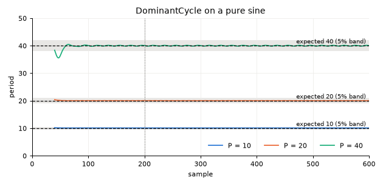

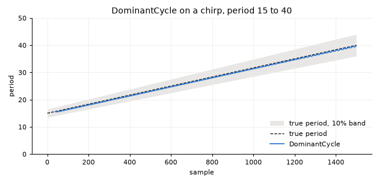

On the chirp the estimate trails the true period by 16 to 20 samples, about
half a cycle, and stays within 2.5% even without allowing for lag.

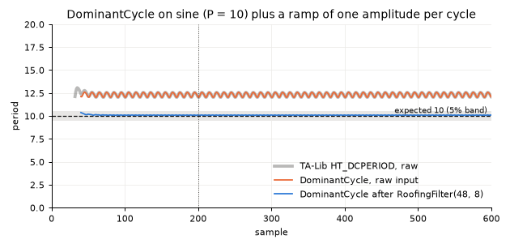

On the raw sine-plus-ramp the estimate is biased: medians 12.3, 20.3, 40.2 for
P 10, 20, 40. TA-Lib gives the same numbers to 1e-11, so this is a property of
the published discriminator, not of our port. Ehlers measures cycles on
roofing-filtered data, and the check follows that recipe. The DominantCycle
page now says that a trending input should go through `RoofingFilter` first,
and gives the [6, 50] range (F5).

## CycleFrequency

Formula: `1 / SmoothPeriod`. Code:
[`cycle_frequency.h`](../../../include/screamer/cycle_frequency.h).
Sine, P 10 / 20 / 40: max error of `P * f - 1` is 1.0% / 0.2% / 0.4%,
tolerance 5%. **PASS.**

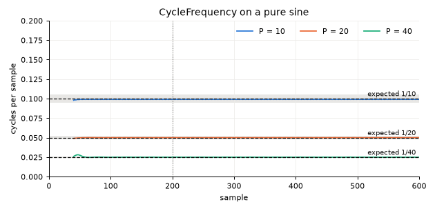

## CycleAmplitude

Convention: Ehlers treats the magnitude of `(I1, Q1)` as the cycle amplitude
in price units. His `.075 Period + .54` factor is a gain correction toward
unit amplitude, and Rocket Science's "Signal-to-Noise Ratio" chapter uses
`I1^2 + Q1^2` as the cycle power, with 0 dB meaning the cycle amplitude equals
half the average bar range. Source: secondary (TradingView ports of Ehlers'
SNR, the ProRealCode SNR page); the book text was not checked. TA-Lib has no
amplitude function. The fix keeps that meaning and makes the unit gain exact:
a sine of amplitude `A` reads `A` at periods from about 7 to 50. (The first
version of this section said no convention existed; the Task 33 review
corrected that.)

Formula (Task 33): `sqrt((I1 / gI)^2 + (Q1 / gQ)^2)`, with `gI = W h` and
`gQ = W h^2` the steady-state gains of `I1` and `Q1` at the engine's period:
`W = |.4 + .3 e^{-iw} + .2 e^{-2iw} + .1 e^{-3iw}|` (the price smoothing) and
`h = 2 adj (.0962 sin 3w + .5769 sin w)` (one pass of the Hilbert FIR with its
correction `adj = .075 Period[1] + .54`), `w = 2 pi / Period`. Code:
[`cycle_amplitude.h`](../../../include/screamer/cycle_amplitude.h),
gains in [`detail/hilbert_cycle.h`](../../../include/screamer/detail/hilbert_cycle.h).

| Check | Expected | Before (median) | After | Result |
|---|---|---|---|---|
| Unit sine, P 10 / 20 / 40, max error | 1 within 5% | 0.41 / 1.08 / 1.41 | 1.006 / 0.999 / 0.998 (max error 0.7%) | PASS |
| Sine of amplitude 3, same periods | 3 within 5% | | max error 0.7% | PASS |

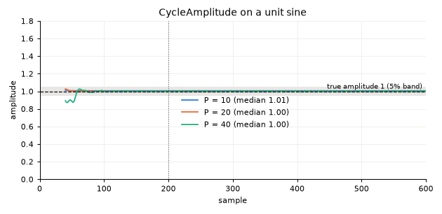

Other periods (median, unit sine): P 8 0.998, P 15 0.999, P 30 1.000, P 50
0.991, P 7 0.989 (median from sample 300). A sine of period 6 reads 1.62
(median from sample 300, up to 2.8), because the engine measures its period
as 18 (DominantCycle on that input gives 18.4, a limit of the published
discriminator at the edge of its range), and the gain is taken at that period.

## HilbertPhasor

Convention: TA-Lib `HT_PHASOR` returns Ehlers' `(I1, Q1)` (Rocket Science,
"Hilbert Transforms"). The operator now returns that pair (2.8.0 returned the
smoothed homodyne pair `(I2, Q2)`). Its scale follows CycleAmplitude: each
component is divided by its gain, so a unit sine gives unit components. TA-Lib
leaves them at Ehlers' approximate unit gain: a unit sine reads 0.71 (P 7) to
1.04 (P 15) for periods 7 to 50 in `HT_PHASOR`, 1.6 to 5.2 below 7 (P 6 1.62,
P 6.5 5.16), and its two components differ in size by up to 12% at period 10.
Code: [`hilbert_phasor.h`](../../../include/screamer/hilbert_phasor.h).

| Check | Expected | After | Result |
|---|---|---|---|
| RMS(Q) / RMS(I), P 10 / 20 / 40 | 1 within 5% | 1.002 / 0.999 / 1.001 (before 0.98 / 1.00 / 1.00) | PASS |
| Lead of Q over I | P/4 within 1 sample | 3 / 5 / 10 samples | PASS |
| Correlation with TA-Lib `HT_PHASOR`, each component, sines | at least 0.999 | 0.999996 or more | PASS |

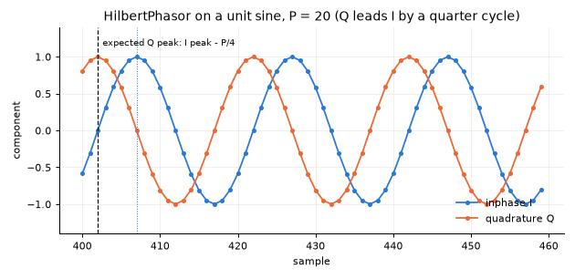

Q leads I. This is Ehlers' convention: the 7-tap Hilbert FIR weights the newest
sample positively, so it acts as a differentiator, and I1 is the delayed centre
sample. It is the conjugate of the textbook analytic signal (where Q lags I).
The page now states the direction and the scale, with the gain formula, so a
user can get `HT_PHASOR`'s values back.

## CyclePhase

Formula: `atan2(Q1, I1)` in degrees, wrapped to [0, 360). Unchanged by Task 33.
Ehlers' published phase is `arctan(Q1 / I1)` (range -90 to 90, used by MAMA);
the sinewave indicator uses a different phase again, the DC phase (TA-Lib
`HT_DCPHASE`, now used by CycleSine and TrendMode). Code:
[`cycle_phase.h`](../../../include/screamer/cycle_phase.h).

| Check | Expected | Measured | Result |
|---|---|---|---|
| Phase change per sample, P 10 / 20 / 40 | -360/P within 5% | 0.97 / 1.00 / 1.00 of it | PASS |
| Offset to the input phase, std after settling | at most 5 degrees | 2.3 / 0.9 / 1.2 | PASS |

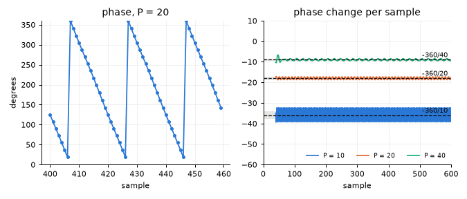

The phase **decreases** by 360/P per sample, the direction of Ehlers' MAMA,
whose `DeltaPhase = Phase[1] - Phase` is positive on a cycle. The page said
the phase "advances"; it now says it decreases (F5). The offset to the input
is a fixed filter delay that depends on P (about -110, 126, 63 degrees for
P 10, 20, 40).

## CycleSine

Convention: Ehlers, Rocket Science, "The Sinewave Indicator", as TA-Lib
`HT_SINE` implements it (ta_HT_SINE.c). Formula, angles in degrees, `s` the
4-tap smoothed price:

```
N = int(SmoothPeriod + .5)
Real = sum_{k<N} sin(360 k / N) s[k],  Imag = sum_{k<N} cos(360 k / N) s[k]
DCPhase = atan(Real / Imag) + 90 + 360 / SmoothPeriod,  + 180 if Imag < 0,
          - 360 if above 315   (Imag = 0: last DCPhase +/- 90 by the sign of Real)
Sine = sin(DCPhase),  LeadSine = sin(DCPhase + 45)
```

DCPhase increases with time and the `360 / SmoothPeriod` term compensates the
lag of the smoothing, so `sine` follows the input in phase and `leadsine`
leads it. 2.8.0 used `CyclePhase`, which decreases, so `leadsine` lagged.
Code: [`cycle_sine.h`](../../../include/screamer/cycle_sine.h),
[`detail/ehlers_sinewave.h`](../../../include/screamer/detail/ehlers_sinewave.h)
(`DcPhase`). Ours builds the unit vector of DCPhase by rotation instead of
calling atan, sin and cos, and sums the Fourier terms in four partial sums;
the values agree with TA-Lib up to rounding.

| Check | Expected | Before | After | Result |
|---|---|---|---|---|
| Period of `sine` from zero crossings | P within 5% | within 1% | within 1% | PASS |
| Lead of `leadsine` over `sine` | +P/8 within 1 sample (1.25 / 2.5 / 5) | -1 / -2 / -5 | 1 / 2 / 5 | PASS |
| Lag of `sine` to the input | 0 within 1 sample | -2 / 3 / 13 | 0 / 0 / 0 | PASS |
| TA-Lib `HT_SINE`, 100 + sine P 10 / 20 / 40, after sample 200 | within 1e-4 | up to 1.98 | 1e-8 / 8e-10 / 3e-6 | PASS |
| TA-Lib `HT_SINE`, random walk, after sample 200 | within 1e-4 | up to 2.0 | 4e-6 (2e-11 after sample 600) | PASS |

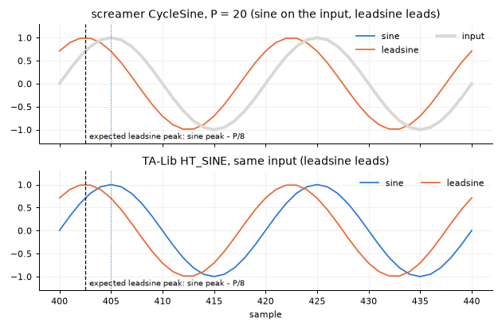

The remaining differences come from the start-up: TA-Lib skips its first
samples and starts its state differently, and the difference decays.

## TrendMode

Convention: Ehlers, Rocket Science, "Identifying Market Modes", as TA-Lib
`HT_TRENDMODE` implements it (ta_HT_TRENDMODE.c). Trend is assumed, then:

```
crossing of Sine and LeadSine: DaysInTrend = 0, cycle
DaysInTrend += 1;  DaysInTrend < .5 SmoothPeriod: cycle
.67 * 360 / SmoothPeriod < DCPhase - DCPhase[1] < 1.5 * 360 / SmoothPeriod: cycle
|(SmoothPrice - Trendline) / Trendline| >= .015: trend
```

The last test overrides the others. Code:
[`trend_mode.h`](../../../include/screamer/trend_mode.h). It reads which side
of `leadsine` the sine is on from DCPhase directly (`sin p - sin(p + 45) =
-2 sin 22.5 cos(p + 22.5)`, so the sine is above for `p` in (67.5, 247.5)),
and evaluates the rule without branches; the results equal TA-Lib's.

The 2.8.0 rule (phase change below `phase_rate_frac * 360 / period`) and its
parameter are gone; TrendMode has no settings.

| Check | Expected | Before | After | Result |
|---|---|---|---|---|
| Pure ramp, share flagged trend | at least 90% | 64% | 100% | PASS |
| 100 + sine plus trend (slope 1/P), share flagged cycle | at least 90% | 100% (on the signal at 0) | 100 / 95 / 100% | PASS |
| Same as TA-Lib `HT_TRENDMODE` after sample 200 (3 sine-plus-trend, ramp, random walk) | identical | 46% agreement on a random walk | identical | PASS |

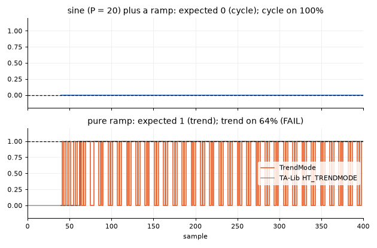

The sine-plus-trend check now sits on a level of 100. The 1.5% test compares
price and trendline in relative terms, made for prices; on the original signal
around 0 the trendline is near zero and TA-Lib and ours both read trend on
25% to 80% of the samples (75 / 41 / 20% cycle). The page says the rule is
meant for price series. On the level-100 signal at P 20 a single sample per
cycle reads trend (the daily count and phase rate both pass there), in TA-Lib
too.

## InstantaneousTrendline

Convention: Ehlers, Rocket Science, "The Instantaneous Trendline", as TA-Lib
`HT_TRENDLINE` implements it (ta_HT_TRENDLINE.c):

```
N = int(SmoothPeriod + .5)
ITrend = mean(Price[0 .. N-1])
Trendline = (4 ITrend + 3 ITrend[1] + 2 ITrend[2] + ITrend[3]) / 10
```

2.8.0 used the 2-pole zero-lag recursion attributed to Cybernetic Analysis with
`a = 2 / (SmoothPeriod + 1)`, which kept about 57% of the cycle. Code:
[`instantaneous_trendline.h`](../../../include/screamer/instantaneous_trendline.h),
[`detail/ehlers_sinewave.h`](../../../include/screamer/detail/ehlers_sinewave.h)
(`CycleTrendline`, sums in TA-Lib's order, so the values are identical).

| Check | Expected | Before | After | Result |
|---|---|---|---|---|
| 100 + sine, P 10 / 20 / 40: residual cycle | at most 1e-6 | about 57% of the cycle | 3e-14 | PASS |
| Ramp: error to the ramp delayed by the published lag | at most 1e-9 | (no lag: 2e-11 to the ramp itself) | 1e-14 | PASS |
| Sine plus trend: error to the trend delayed by the published lag | 0.2 / 0.1 / 0.1 of the amplitude | 1.08 / 0.98 / 1.35 | 0.155 / 0.039 / 0.064 | PASS |
| Same as TA-Lib `HT_TRENDLINE` after sample 200 (sines plus trend, random walk) | within 1e-9 | up to 10.1 | 0 | PASS |

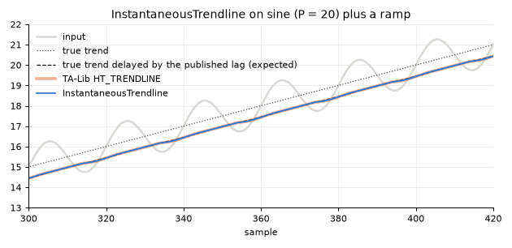

The published lag on a ramp is `sum_j w_j (j + (N[t-j] - 1) / 2)` with WMA
weights `w = .4, .3, .2, .1`, about half a cycle plus one sample. Against the
undelayed trend the error is 0.78 / 0.59 / 0.58 (it was 0.54 / 0.68 / 0.84),
so the fix trades the 2.8.0 zero lag for removing the cycle; that is the
convention. At P 10 the check allows 0.2 instead of 0.1: the ramp biases the
measured period to 12 or 13 (TA-Lib `HT_DCPERIOD` gives the same), and a mean
over 12 or 13 samples leaves up to 0.15 of a 10-sample cycle. TA-Lib gives the
identical output on that signal.

## MAMA

Convention: Ehlers, "MESA Adaptive Moving Averages" (S&C, September 2001, see
Sources) and Rocket Science, as TA-Lib `MAMA` implements it (ta_MAMA.c):
`Phase = arctan(Q1 / I1)` in degrees (0 when `I1 = 0`), `DeltaPhase =
max(Phase[1] - Phase, 1)`, `alpha = clip(fast_limit / DeltaPhase, slow_limit,
fast_limit)`, MAMA an EMA with `alpha`, FAMA an EMA of MAMA with `alpha / 2`.
2.8.0 used `CyclePhase`, `atan2(Q1, I1)`, which wraps once per cycle. Code:
[`mama.h`](../../../include/screamer/mama.h).

| Check | Expected | Before | After | Result |
|---|---|---|---|---|
| Effective alpha between wraps, P 10 / 20 / 40 | `clip(0.5 P / 360, 0.05, 0.5)` = 0.05 / 0.05 / 0.056 within 5% | 0.05 / 0.05 / 0.055 | 0.05 / 0.05 / 0.056 | PASS |
| `fast_limit` steps per cycle | 2 within 5% (Ehlers, TA-Lib) | 1.00 / 1.00 / 1.02 | 1.99 / 2.00 / 2.00 | PASS |
| TA-Lib `MAMA`, 5 + sine and random walk, after sample 600 | within 1e-6 | up to 3.2 | 8e-11 at most | PASS |

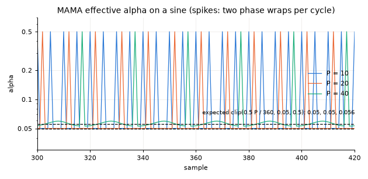

Ours seeds MAMA and FAMA with the first input after the warm-up; TA-Lib starts
both at 0, so the two differ in the first few hundred samples (FAMA, with half
the smoothing constant, longest). The page's description of the adaptation was
backwards (it said `alpha` rises "when the phase advances quickly"); it now
says `alpha` reaches `fast_limit` when the phase stalls or wraps (F5).

## SuperSmoother

Formula (Cycle Analytics, chapter 3 per the catalog; not verified):
`a1 = exp(-1.414 pi / P)`, `b1 = 2 a1 cos(1.414 pi / P)`, `c2 = b1`,
`c3 = -a1^2`, `c1 = 1 - c2 - c3`, `y = c1 (x + x[1]) / 2 + c2 y[1] + c3 y[2]`.
Code: [`super_smoother.h`](../../../include/screamer/super_smoother.h),
coefficients in [`signal/ehlers.h`](../../../include/screamer/signal/ehlers.h).
The existing `tests/test_ehlers_filters.py` matches this formula to 1e-12.

Gain at the cutoff period, P 10 / 20 / 40: -3.16 / -3.05 / -3.02 dB, tolerance
-3 dB within 1 dB. **PASS.** The true -3 dB point sits at 10.17 / 20.08 / 40.05.

## Decycler

Formula (Cycle Analytics, chapter 4 per the catalog; not verified):
`alpha = (cos(360/P) + sin(360/P) - 1) / cos(360/P)`,
`y = alpha/2 (x + x[1]) + (1 - alpha) y[1]`. Code:
[`decycler.h`](../../../include/screamer/decycler.h).

Gain at the cutoff, P 20 / 60: -3.01 / -3.01 dB. **PASS.** At the cutoff the
Decycler passes 71% of a cycle, so "cycles at or below this length are removed"
on the page was loose; the page now defines the cutoff as the half-power point
and says that cycles well below it are removed (F5). On a ramp it lags by about
9.5 samples at P 60 (informational).

## RoofingFilter

Formula (S&C January 2014, verified in F1 as the source; the formula itself not
checked against the article): a 2-pole high-pass with
`alpha = (cos(.707 360/HP) + sin(.707 360/HP) - 1) / cos(.707 360/HP)`,
`hp = (1 - alpha/2)^2 (x - 2x[1] + x[2]) + 2(1 - alpha) hp[1] - (1 - alpha)^2 hp[2]`,
then a SuperSmoother at the low-pass period. Code:
[`roofing_filter.h`](../../../include/screamer/roofing_filter.h).

Gain with `hp_period=48, lp_period=10`: -3.54 dB at 48, -3.33 dB at 10.
**PASS.** Each edge carries a little extra loss from the other stage.

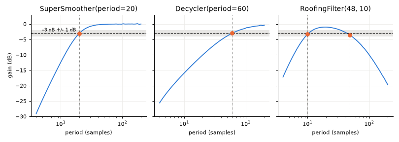

## Where TA-Lib still differs

The Task 33 review cross-checked more signals (walks at level 100 and 0,
geometric walks, sines P 7 to 48, chirps, a noisy sine, a ramp). Two cases
differ from TA-Lib after sample 200: a pure ramp (InstantaneousTrendline 3e-2,
MAMA 0.12) and a sine of period 48 (InstantaneousTrendline 2e-2, until about
sample 633). Both come from DominantCycle differing from `HT_DCPERIOD` there
(3.3 on the ramp, 0.1 on the sine), which Task 33 did not change: on a pure
ramp the detrended input is nearly constant, the discriminator's period loop
is chaotic, and last-bit differences between the two implementations grow.
Everything downstream of the period follows TA-Lib exactly once the periods
agree.

## Decisions taken (Task 33)

The user's rule (2026-10-13): follow the popular convention of the papers and
other libraries; where none exists, choose for internal consistency.

1. CycleSine: adopt Ehlers' DC phase, as TA-Lib `HT_SINE` (convention).
2. CycleAmplitude and HilbertPhasor: HilbertPhasor returns TA-Lib
   `HT_PHASOR`'s pair `(I1, Q1)` (convention); both keep Ehlers' meaning of
   `|(I1, Q1)|` as the cycle amplitude at unit gain and make that gain exact.
3. TrendMode: adopt Ehlers' rule, as TA-Lib `HT_TRENDMODE` (convention); the
   `phase_rate_frac` parameter is removed.
4. InstantaneousTrendline: adopt the Rocket Science trendline, as TA-Lib
   `HT_TRENDLINE` (convention); it lags a ramp by half a cycle.
5. MAMA: align with Ehlers' `arctan` phase, as TA-Lib `MAMA` (convention).
6. Doc fixes (F5): done on the CyclePhase, MAMA, DominantCycle, CycleSine,
   CycleAmplitude, HilbertPhasor, Decycler and InstantaneousTrendline pages.

Speed (bench_all_ops, 1-D, ns per element, before to after): TrendMode 50.2 to
69.8 (1.39x; the one-cycle Fourier sum, the arctangent and the trendline sum
are new work), CycleSine 53.1 to 51.3, InstantaneousTrendline 48.5 to 46.3,
MAMA 48.5 to 46.5, the other five engine operators 3% to 5% faster.
